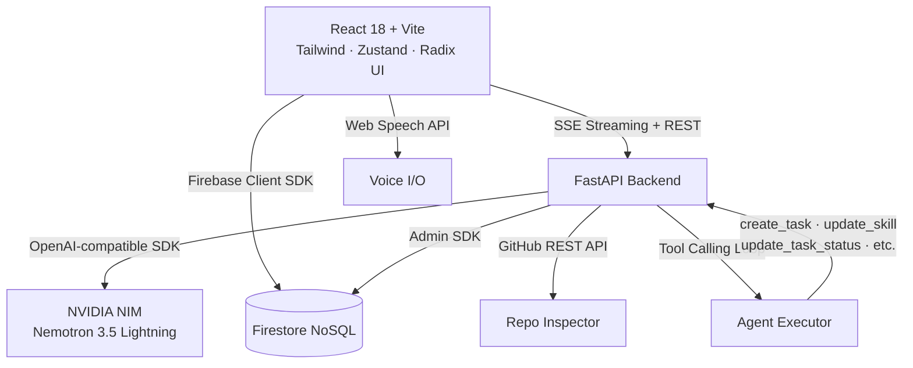

<div align="center">
  

  
  <h3>AI-Powered Career Operating System with Agentic Tool Calling</h3>
  <p><em>Multi-step AI agent with real function calling, SSE streaming, human-in-the-loop approval, voice tutoring, and 1-click Kanban auto-scheduling.</em></p>

  <p>
    <a href="https://level-up-new.vercel.app"></a>
    <a href="https://levelup-new-backend.onrender.com"></a>
    <a href="https://github.com/Prajeeth-12/LevelUP-new/tree/new-theme-layrs"></a>
  </p>

  <p>
    
    
    
    
    
    
    
  </p>
</div>

---

## 📌 Table of Contents
- [Executive Overview](#-executive-overview)
- [The Problem vs. LevelUP Solution](#-the-problem-vs-levelup-solution)
- [Visual Product Walkthrough & Screenshots](#-visual-product-walkthrough--screenshots)
  - [1. Authentication & Onboarding](#1-authentication--onboarding)
  - [2. Mission Control Dashboard](#2-mission-control-dashboard)
  - [3. Multimodal AI Assistant & Voice Tutor](#3-multimodal-ai-assistant--voice-tutor)
  - [4. 3-Column Kanban Board & 1-Click Auto-Scheduler](#4-3-column-kanban-board--1-click-auto-scheduler)
  - [5. Skill Gap Analyzer & Job Description Matcher](#5-skill-gap-analyzer--job-description-matcher)
  - [6. Conversational AI Learning Path Recommender](#6-conversational-ai-learning-path-recommender)
  - [7. Career Portfolio & Readiness Score](#7-career-portfolio--readiness-score)
  - [8. Engineering Analytics & Mastery Buckets](#8-engineering-analytics--mastery-buckets)
  - [9. User Profile, Settings & JSON Data Portability](#9-user-profile-settings--json-data-portability)
- [System Architecture](#-system-architecture)
- [Core API Reference](#-core-api-reference)
- [Local Setup & Execution Guide](#-local-setup--execution-guide)
- [Verified Production Deployments](#-verified-production-deployments)

---

## 💡 Executive Overview

**LevelUP** is an AI-powered personal career operating system engineered to bridge the modern software developer skill gap. Instead of overwhelming learners with static course catalogs or rigid checklists, LevelUP pairs each engineer with an active, multimodal AI mentor that dynamically benchmarks their skills against real-world job descriptions, schedules balanced Kanban sprints, and engages in voice-first 1-on-1 tutoring.

---

## 🎯 The Problem vs. LevelUP Solution

| Traditional Learning Platforms | The LevelUP OS Solution |
|---|---|
| **Course Overload:** Thousands of disconnected video lectures without structured sequencing. | **Goal-Driven Roadmaps:** AI breaks career targets into chronological, milestone-driven phases with prerequisites. |
| **Backlog Burnout:** Kanban boards accumulate hundreds of tasks without considering cognitive bandwidth. | **1-Click Auto-Scheduler:** Analyzes weekly hours (e.g. 12h/week) and isolates 2–4 high-leverage focus tasks for today's active sprint. |
| **Passive Consumption:** Watching tutorials produces an illusion of competence without active verification. | **Voice-First AI Tutor & Vision Inspector:** Spoken technical mock interviews and drag-and-drop system architecture verification. |
| **Vendor Lock-in:** Progress is trapped inside proprietary walled gardens. | **100% Data Portability:** One-click JSON data export of all categories, skills, tasks, and roadmaps. |

---

## 📸 Visual Product Walkthrough & Screenshots

### 1. Authentication & Onboarding
Seamless onboarding featuring our warm minimalist Layrs design system, Google One-Tap authentication, JWT Bearer verification, and inline password recovery.

<div align="center">
  
  <p><em>Figure 1: LevelUP Authentication Suite with Google OAuth and Email/Password flow</em></p>
</div>

---

### 2. Mission Control Dashboard
Central command center aggregating active career roadmaps, interactive daily knowledge prompts, cycle statistics, and today's priority tasks with a smooth fixed-rail sidebar.

<div align="center">
  
  <p><em>Figure 2: Core Dashboard featuring Daily Question Prompts, Cycle Stats Bar, and Multi-Roadmap Manager</em></p>
</div>

---

### 3. Multimodal AI Assistant & Voice Tutor
Embedded AI mentor powered by **MiniMax-M3 LLM** with real-time Speech-to-Text, spoken Text-to-Speech audio playback, diagram/whiteboard vision inspection, and **Human-in-the-Loop Action Cards** (`[+ Approve & Save]`).

<div align="center">
  
  <p><em>Figure 3: AI Chat Assistant with Voice Waveform, Vision Attachments, and Interactive Action Cards</em></p>
</div>

---

### 4. 3-Column Kanban Board & 1-Click Auto-Scheduler
Structured task execution categorized into **To Do**, **Current**, and **Past**. The **AI Auto-Schedule** button analyzes weekly study budgets and balances today's sprint automatically. Supports seamless instant theme toggling between Light and Dark modes.

<div align="center">
  
  <p><em>Figure 4: 3-Column Kanban Board in Light Theme with AI Auto-Schedule Engine</em></p>
  <br/>
  
  <p><em>Figure 5: 3-Column Kanban Board in Dark Theme for late-night coding sessions</em></p>
</div>

---

### 5. Skill Gap Analyzer & Job Description Matcher
Upload an existing resume (PDF/DOCX/TXT), dial in your **Weekly Study Bandwidth** (4h to 40h/week), and match against target roles or raw job postings to extract missing skills and tailored milestones.

<div align="center">
  
  <p><em>Figure 6: Skill Gap Analyzer with Resume Upload, Bandwidth Slider, and Custom JD Parser</em></p>
</div>

---

### 6. Conversational AI Learning Path Recommender
Describe learning objectives in natural language (*"Become an AI Agent Engineer in 8 weeks"*) or choose curated industry presets to synthesize multi-phase roadmaps with prerequisites and project deliverables.

<div align="center">
  
  <p><em>Figure 7: Conversational Goal Intake and Adaptive Learning Path Recommender</em></p>
</div>

---

### 7. Career Portfolio & Readiness Score
Verified proof of engineering competencies, readiness score aggregation, and one-click portfolio export for resume inclusion and hiring managers.

<div align="center">
  
  <p><em>Figure 8: Career Portfolio with Mastery Stats and Export Portfolio Action</em></p>
</div>

---

### 8. Engineering Analytics & Mastery Buckets
Track learning velocity, task completion efficiency, study consistency streaks, and competency breakdowns across 5 mastery tiers (0% to 100%).

<div align="center">
  
  <p><em>Figure 9: Engineering Analytics Dashboard with Task Efficiency and Progress Buckets</em></p>
</div>

---

### 9. User Profile, Settings & JSON Data Portability
Manage personal education credentials, multi-language/skill tags, and perform 1-click full database JSON backups with zero lock-in.

<div align="center">
  <table>
    <tr>
      <td width="50%"></td>
      <td width="50%"></td>
    </tr>
    <tr>
      <td align="center"><em>Figure 10: User Profile & Skill Tags</em></td>
      <td align="center"><em>Figure 11: Settings & 1-Click JSON Data Export</em></td>
    </tr>
  </table>
</div>

---

## 🏗️ System Architecture

### High-Level Overview



### Agentic AI Architecture (the core differentiator)

The chat agent uses **real OpenAI function calling** with a **multi-step reasoning loop** — not prompt engineering that hopes for valid JSON.

```
┌─────────────────────────────────────────────────────────┐
│  User: "I finished React hooks, update progress and     │
│         add a task for Redux next"                      │
└──────────────────────┬──────────────────────────────────┘
                       │
                       ▼
┌──────────────────────────────────────────────────────────┐
│  AGENT LOOP (max 5 iterations)                           │
│                                                          │
│  Iteration 1:                                            │
│    LLM → tool_call: update_skill_progress                │
│           ("React hooks", progress=100)                  │
│    → Result fed back to LLM                              │
│                                                          │
│  Iteration 2:                                            │
│    LLM → tool_call: create_task                          │
│           ("Learn Redux", priority="HIGH")               │
│    → Result fed back to LLM                              │
│                                                          │
│  Iteration 3:                                            │
│    LLM → text: "Done! Updated React hooks to 100%       │
│           and added a HIGH priority Redux task."         │
│    → Loop exits                                          │
└──────────────────────┬──────────────────────────────────┘
                       │
                       ▼
┌──────────────────────────────────────────────────────────┐
│  FRONTEND: Human-in-the-loop approval                    │
│                                                          │
│  ┌─ Proposed Workspace Changes (2) ──────────────────┐   │
│  │  ✏️ Update: React hooks → 100%                     │   │
│  │  ➕ Task: Learn Redux (HIGH)                       │   │
│  │                                                    │   │
│  │  [ Approve & Save (2) ]  [ Dismiss ]              │   │
│  └────────────────────────────────────────────────────┘   │
└──────────────────────────────────────────────────────────┘
```

**Key design decisions:**
- **Tool calling > prompt engineering:** Actions come from structured `tool_calls` in the OpenAI SDK, not regex-parsed JSON text. Zero parsing failures.
- **Agent loop > single-shot:** The LLM can chain 2-5 tool calls per turn, each informed by the results of the previous call.
- **Human-in-the-loop:** Tool results are "proposed" — the user approves before mutations hit Firestore. No autonomous writes.
- **SSE streaming:** Tokens appear in real-time via `POST /ai/chat/stream` using Server-Sent Events. Tool calls during streaming are emitted as separate SSE events.
- **Graceful fallback:** If the model doesn't support tool calling, the system falls back to prompt-based JSON parsing (backward compatible with any OpenAI-compatible model).

### Available Agent Tools

| Tool | What it does |
|---|---|
| `create_task` | Add a task to the Kanban board |
| `update_task_status` | Move task between To Do / In Progress / Completed |
| `update_task_priority` | Change task priority (HIGH / MEDIUM / LOW) |
| `delete_task` | Remove a task |
| `create_skill` | Add a skill to the portfolio |
| `update_skill_progress` | Set skill progress (0-100%) |

### Onboarding Agent

New users go through a 4-step profile setup. On completion, the **onboarding agent** runs the tool-calling loop to:
1. Create 3-5 tracked skills from their profile
2. Create a learning task for each skill
3. Save their career goal

The user arrives at a pre-populated dashboard on first login — not an empty page.

### Tech Stack

| Layer | Technology |
|---|---|
| Frontend | React 18, Vite, Tailwind CSS, Zustand, React Query, Radix UI, Framer Motion, `@dnd-kit` |
| Backend | FastAPI, Uvicorn, Pydantic, AsyncOpenAI SDK |
| AI Model | NVIDIA Nemotron 3.5 Lightning (30B MoE, 1M context, free on NIM) |
| Database | Google Cloud Firestore (NoSQL) |
| Auth | Firebase Authentication (Google OAuth + Email/Password) |
| Voice | Browser Web Speech API (recognition + synthesis) |
| NLP | spaCy (skill extraction from resumes) |
| Deploy | Vercel (frontend) + Render (backend) |

---

## ⚡ Core API Reference

| Method | Endpoint | Description |
|---|---|---|
| `POST` | `/ai/chat` | Agentic chat with tool calling — returns actions + reply |
| `POST` | `/ai/chat/stream` | SSE streaming version of chat — tokens arrive in real-time |
| `POST` | `/ai/onboard` | Onboarding agent — auto-creates skills and tasks from profile |
| `POST` | `/ai/auto-organize-tasks` | Kanban sprint scheduler balancing weekly hour budgets |
| `POST` | `/ai/skill-gap` | Benchmark skills against a target role |
| `POST` | `/ai/generate-subskills` | Decompose skills into actionable subskill checklists |
| `POST` | `/ai/task-plan` | Prioritize and sequence tasks by available study time |
| `POST` | `/ai/progress-insights` | Personalized coaching from activity data |
| `POST` | `/api/v1/analyze-gap` | Resume upload + JD matching (PDF/DOCX/TXT) |
| `POST` | `/api/v1/recommend/conversational-plan` | AI learning path generator |
| `POST` | `/api/students/profile` | Create/update student profile |
| `GET`  | `/api/career/roadmap` | Fetch active career roadmap |

---

## 🚀 Local Setup & Execution Guide

### 1. Prerequisites
- **Node.js** (v18+) & **Python** (v3.10+)
- **Git**

```bash
# Clone repository and switch to the active branch
git clone https://github.com/Prajeeth-12/LevelUP-new.git
cd LevelUP-new
git checkout new-theme-layrs
```

### 2. Backend Setup (FastAPI)
```bash
cd backend
python -m venv venv

# Activate Virtual Environment:
# Windows: .\venv\Scripts\activate
# macOS/Linux: source venv/bin/activate

pip install -r requirements.txt
```

Create `backend/.env` (copy from `.env.example`):
```env
PROJECT_NAME="LevelUP"
ENV="development"

# NVIDIA NIM (free — get key at build.nvidia.com)
OPENAI_API_KEY="nvapi-your-key-here"
OPENAI_BASE_URL="https://integrate.api.nvidia.com/v1"
OPENAI_MODEL="nvidia/nemotron-3.5-lightning-30b-a3b"

FIREBASE_SERVICE_ACCOUNT_PATH="firebase-service-account.json"
```

Start backend:
```bash
python -m uvicorn app.main:app --port 8000 --reload
```
- API Base: `http://localhost:8000`
- Swagger Docs: `http://localhost:8000/docs`

### 3. Frontend Setup (React + Vite)
In a second terminal:
```bash
cd frontend
npm install
npm run dev -- --port 3000
```
- Web Application: `http://localhost:3000`

---

## 🌐 Verified Production Deployments

- **Live Application (Vercel):** [https://level-up-new.vercel.app](https://level-up-new.vercel.app)
- **Backend API Service (Render):** [https://levelup-new-backend.onrender.com](https://levelup-new-backend.onrender.com)
- **GitHub Repository:** [https://github.com/Prajeeth-12/LevelUP-new](https://github.com/Prajeeth-12/LevelUP-new) (Branch: `new-theme-layrs`)
- **Documentation (PDF):** [`docs/LevelUP_Solution_Documentation.pdf`](docs/LevelUP_Solution_Documentation.pdf)

---

<div align="center">
  <sub>Built with ❤️ for the LevelUP Engineering Challenge.</sub>
</div>
